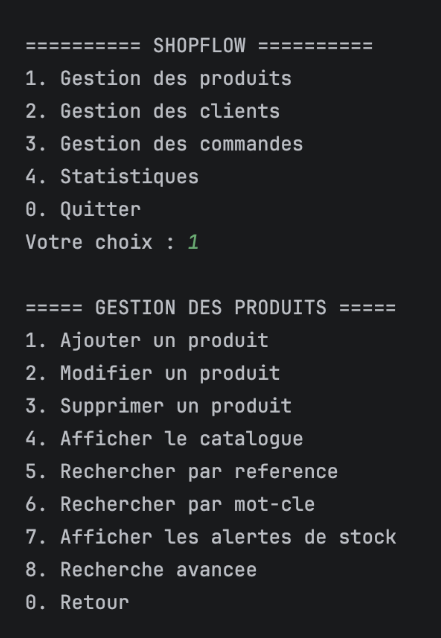
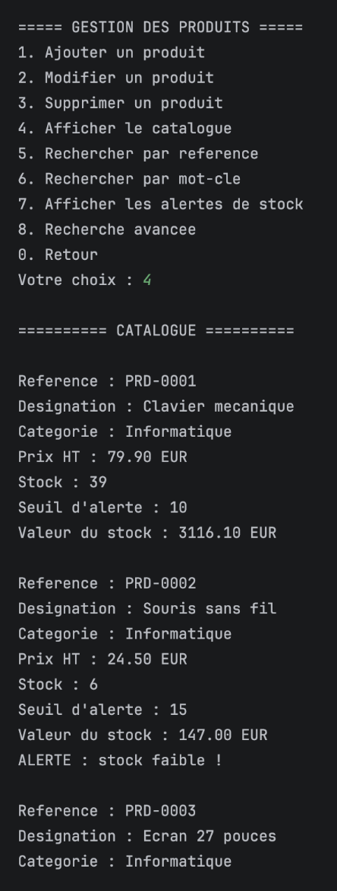
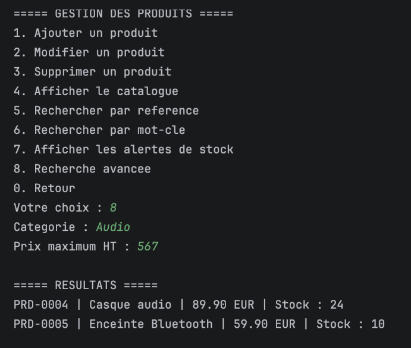
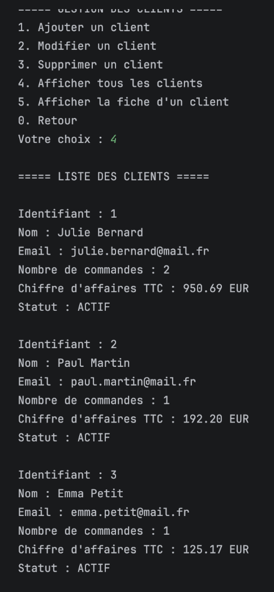
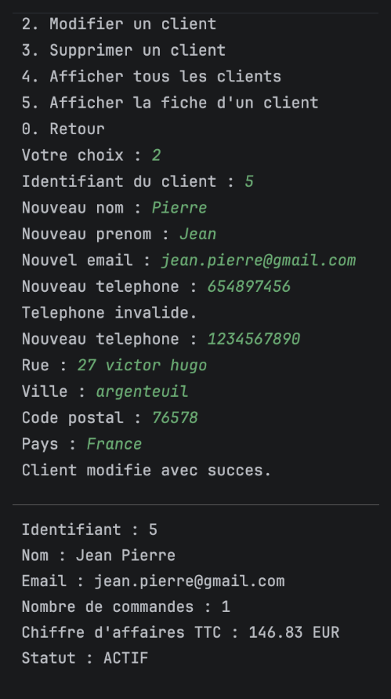
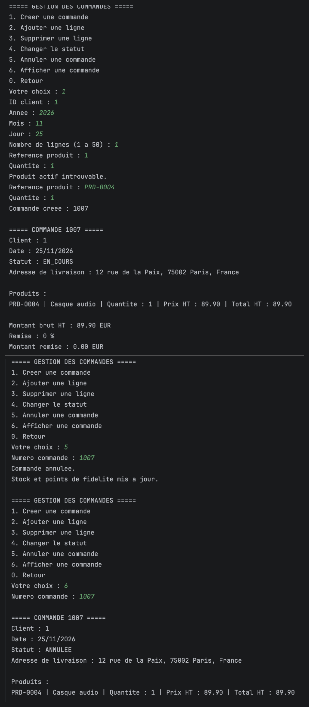
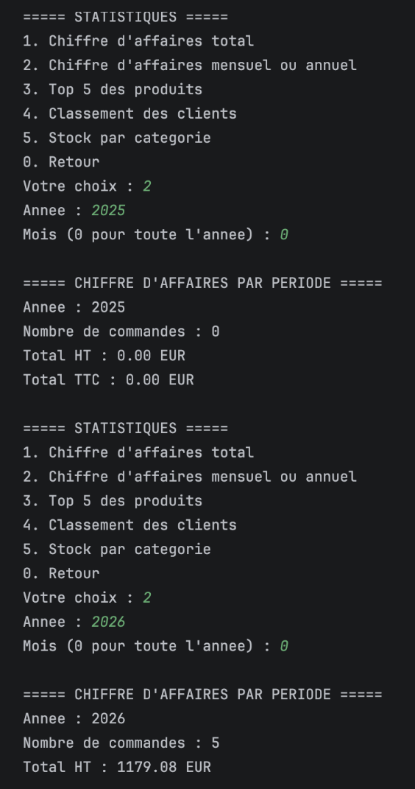
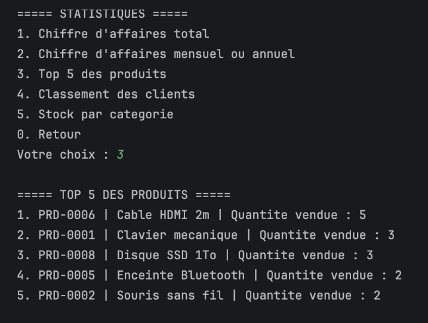
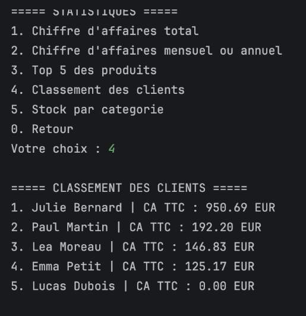
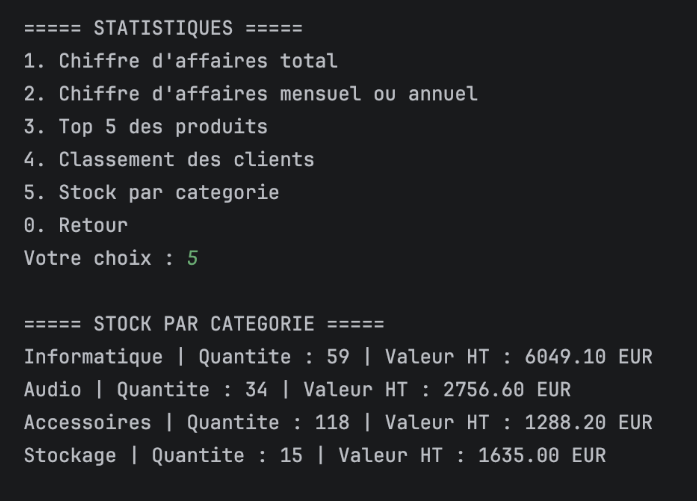

# ShopFlow – Retail Management System


## Project Overview

ShopFlow is a command-line retail management system developed in C as part of an academic group project at EFREI Paris.

The application provides an integrated solution for managing products, customers, orders, inventory and business statistics. It focuses on structured programming, modular architecture, data validation and the implementation of retail business logic.

## Main Features

### Product & Inventory Management

- Add, update and delete products
- Display the complete product catalog
- Search products by reference or keyword
- Advanced filtering by category and maximum price
- Low-stock alerts based on predefined thresholds
- Inventory value calculation

### Customer Management

- Add, update and delete customer records
- Display customer lists and individual profiles
- Manage customer contact and address information
- Validate user input
- Track customer orders and revenue

### Order Management

- Create and manage customer orders
- Add or remove order items
- Update order status
- Cancel existing orders
- Validate product references
- Calculate order amounts and discounts
- Update stock and loyalty points upon order cancellation

### Business Statistics

- Total revenue calculation
- Monthly and annual revenue analysis
- Top 5 best-selling products
- Customer ranking based on revenue
- Inventory quantity and value by category

## Technologies & Tools

| Technology | Purpose |
|---|---|
| C | Core application development |
| CMake | Build configuration and compilation |
| CLion | Development environment |
| Git | Version control |
| GitHub | Collaborative development |
| CLI | Interactive command-line interface |

## Technical Skills Demonstrated

- Modular programming in C
- Separation of source and header files
- CRUD operations
- Input validation and error handling
- Search, filtering and ranking operations
- Inventory and order management logic
- Financial calculations and data aggregation
- Collaborative development using Git and GitHub

## Project Structure

```text
MiniprojetShopflow/
├── screenshots/
├── .gitignore
├── CMakeLists.txt
├── README.md
├── main.c
├── client.c
├── client.h
├── commande.c
├── commande.h
├── produit.c
├── produit.h
├── statistique.c
├── statistique.h
├── initialisation.c
├── initialisation.h
└── utils.c
```

## Installation & Usage

### Prerequisites

- A C compiler (GCC or Clang)
- CMake
- Git

### Clone the Repository

```bash
git clone https://github.com/Janushka-hub/MiniprojetShopflow.git
cd MiniprojetShopflow
```

### Build the Application

```bash
cmake -S . -B build
cmake --build build
```

### Run the Application

On macOS or Linux:

```bash
./build/ShopFlow
```

The application can also be opened, built and executed directly using CLion.

## Application Screenshots

### 1. Main Menu

Interactive navigation between the four main application modules.



### 2. Product Catalog & Stock Alerts

Product information, pricing, inventory valuation and low-stock detection.



### 3. Advanced Product Search

Product filtering based on category and maximum price.



### 4. Customer Management

Customer profiles, order history summaries and revenue tracking.



### 5. Customer Update & Input Validation

Customer information modification, invalid input detection and verification of the updated record.



### 6. Order Creation & Cancellation

Order creation, product reference validation, order cancellation and stock and loyalty point updates.



### 7. Revenue Analysis

Revenue calculations for selected monthly or annual periods.



### 8. Best-Selling Products

Ranking of the five best-selling products by quantity sold.



### 9. Customer Ranking

Customer ranking based on generated revenue.



### 10. Inventory Statistics

Stock quantity and inventory value grouped by product category.



## Academic Context

- Institution: EFREI Paris
- Project type: Academic group project
- Programming language: C
- Development approach: Collaborative and modular programming

## Contributors

Developed collaboratively by the project team as part of the Computer Science curriculum at EFREI Paris.

## Project Status

Academic project with implemented core retail management functionalities.
